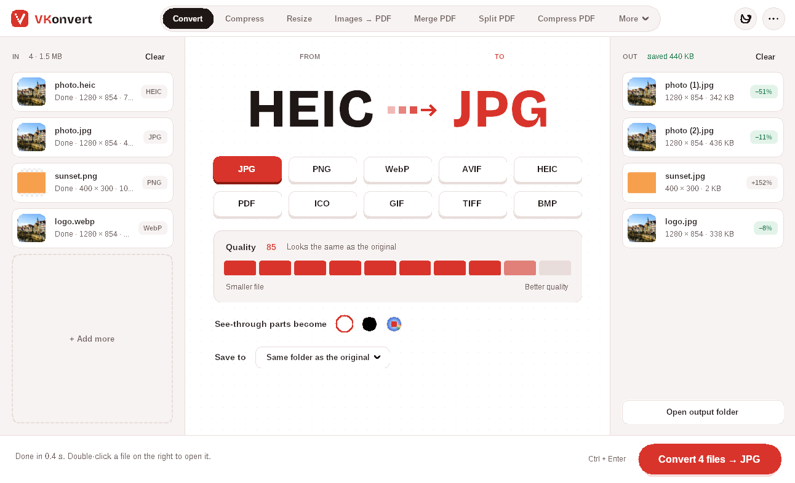
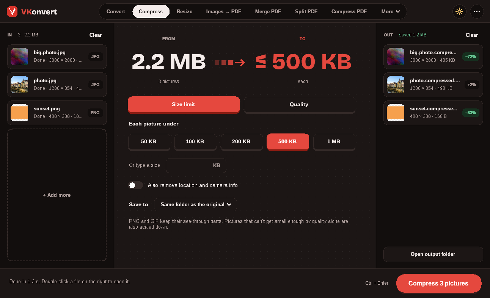
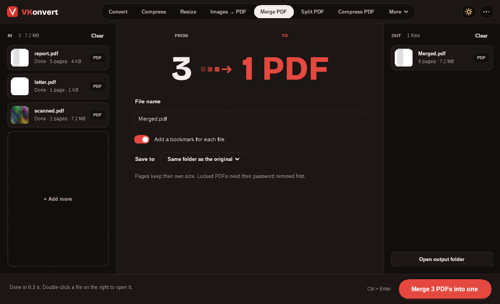
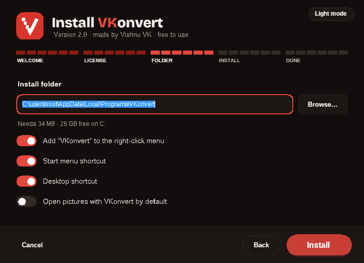

<p align="center">
  
</p>

<h1 align="center">VKonvert</h1>

<p align="center"><b>Convert, compress and combine images and PDFs. Free, offline, private.</b><br>
Made by Vishnu VK · Made with Claude Code · MIT License</p>



VKonvert is a free Windows app for everyday picture and PDF jobs. Files come in on the left, you pick what to do in the middle, and the finished files land on the right. Everything happens on your PC: nothing is uploaded.

## Download

Get **VKonvert-Setup-2.0.exe** from the [Releases](../../releases) page and run it. Setup asks you to accept the license, lets you choose the install folder and options, and needs no admin rights. VKonvert then appears in the Start menu and in **Settings › Apps**, where you can uninstall it any time.

Windows may show "Windows protected your PC" because the app isn't code-signed yet. Click **More info › Run anyway**.

## Tools

| Pictures | PDF |
|---|---|
| **Convert** between JPG, PNG, WebP, AVIF, HEIC, GIF, TIFF, BMP, ICO and PDF | **Images → PDF**, in the order you choose, on A4, Letter or picture-sized pages |
| **Compress** to a size limit (50 KB, 100 KB, 500 KB…) or a quality | **Merge** several PDFs into one, with a bookmark per file |
| **Resize** by long side, percent, square post or passport photo | **Split** into page ranges, or one file per page |
| **Remove photo info** (location, camera, date) before sharing | **Compress PDF**: scanned and photo PDFs often shrink by 80–90% |
| | **PDF to images** at 96, 150 or 300 dpi |
| | **Rotate & reorder** pages with thumbnails |
| | **Protect** with a password (AES-256) |

It also adds a **VKonvert** submenu to the right-click menu of pictures and PDFs, including one-click "Convert to JPG/PNG/WebP…".

<p>
  
  
</p>

Light and dark mode: the sun/moon button switches, or **••• › Appearance › Match Windows**.



## Privacy

VKonvert works fully offline. It doesn't upload files, doesn't collect data and doesn't phone home. Originals are never changed or overwritten; new files are saved next to them (or in a folder you choose) as `photo-compressed.jpg`, `photo (1).jpg` and so on.

## Build from source

The app is C# / WinForms on .NET Framework 4.8 (built into Windows 10 and 11). It builds on Windows, macOS or Linux with the .NET 8 SDK:

```bash
./build.sh            # → dist/VKonvert-Setup-2.0.exe
```

| Folder | What's in it |
|---|---|
| `app/` | The app: `MainForm.cs` (window), `Tools.cs` (the 11 tools), `Engine/` (image and PDF work), `UI/` (theme and controls) |
| `setup/` | The installer (Welcome → License → Folder & options → Install → Done) |
| `brand/` | Logo and icon files |
| `licenses/` | Licenses of the libraries VKonvert includes |

VKonvert uses [Magick.NET](https://github.com/dlemstra/Magick.NET) (ImageMagick) for pictures, [PDFsharp](https://www.pdfsharp.com/) for PDF editing, [PDFium](https://pdfium.googlesource.com/pdfium/) for drawing PDF pages, and the [Bricolage Grotesque](https://github.com/ateliertriay/bricolage) font for the logo.

## License

MIT © 2026 Vishnu VK. See [LICENSE](LICENSE). Third-party licenses are in [`licenses/`](licenses) and are shipped with the app as `THIRD-PARTY-NOTICES.txt`.
